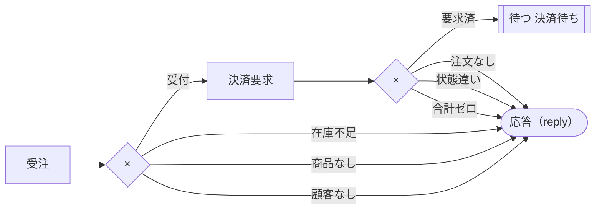
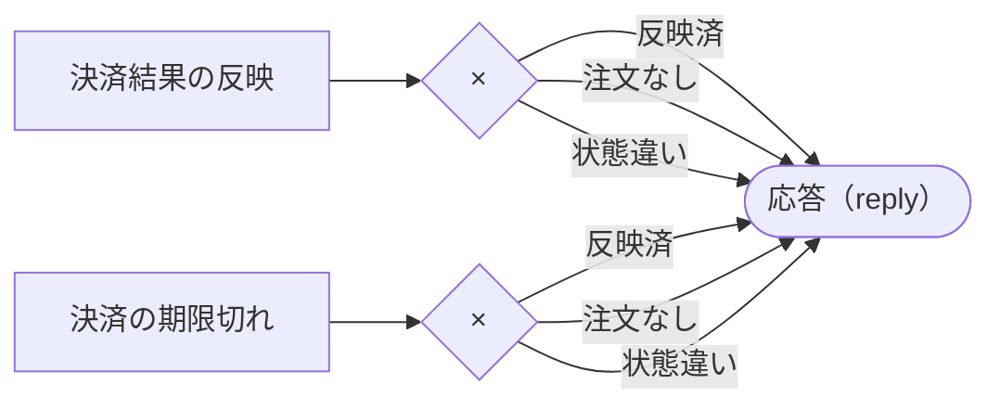

# 生成した仕様書（③）（shop.geas）

コードから生成。人が直さない。◆の欄は plan の仕様書（①）と機械で突合する。

## データ

| データ | 項目 | ◆型・範囲 | ◆必須 | ◆一意 |
|---|---|---|---|---|
| 商品 | 商品ID | ID | ○ | ○ |
| 商品 | 在庫 | 整数 0.. | ○ |  |
| 商品 | 単価 | 金額(円) 0.. | ○ |  |
| 顧客 | 顧客ID | ID | ○ | ○ |
| 注文 | 注文ID | ID | ○ | ○ |
| 注文 | 顧客 | 顧客 を参照 | ○ |  |
| 注文 | 明細 | 商品 → 整数 1..99 | ○ |  |
| 注文 | 合計 | 金額(円) 0.. | ○ |  |
| 注文 | 状態 | 注文状態 | ○ |  |

## 状態と遷移

| データ | ◆状態 | ◆区分 |
|---|---|---|
| 注文 | 受付 | 初期 |
| 注文 | 決済要求済 | 中間 |
| 注文 | 完了 | 終了 |
| 注文 | キャンセル | 終了 |

| データ | ◆元 | ◆先 | ◆起こす処理 |
|---|---|---|---|
| 注文 | (新規) | 受付 | 受注 |
| 注文 | 受付 | 決済要求済 | 決済要求 |
| 注文 | 決済要求済 | 完了 | 決済結果の反映 |
| 注文 | 決済要求済 | キャンセル | 決済の期限切れ |

| データ | ◆元 | ◆先 | 拒否の理由 |
|---|---|---|---|
| 注文 | 完了 | キャンセル | 完了後は返品で扱う |

## 処理

| 処理 | ◆入力 | ◆読む | ◆書く | ◆結果 → 行き先 | ◆外部作用 |
|---|---|---|---|---|---|
| 受注 | 顧客ID（必須）, 明細（必須） | 顧客, 商品.在庫, 商品.単価 | 注文, 商品.在庫 | 受付→決済要求 / 在庫不足→応答 / 商品なし→応答 / 顧客なし→応答 | なし |
| 決済要求 | 注文ID（必須） | 注文.状態, 注文.合計 | 注文.状態 | 要求済→待つ 決済待ち / 注文なし→応答 / 状態違い→応答 / 合計ゼロ→応答 | 決済.請求(冪等キー=注文ID) |
| 決済結果の反映 | 注文ID（必須） | 注文.状態 | 注文.状態 | 反映済→応答 / 注文なし→応答 / 状態違い→応答 | なし |
| 決済の期限切れ | 注文ID（必須） | 注文.状態 | 注文.状態 | 反映済→応答 / 注文なし→応答 / 状態違い→応答 | なし |

## フロー図 OrderIntake（×＝結果で行き先が分かれる、＋＝並列に起こす）

## フロー図 PaymentRelease（×＝結果で行き先が分かれる、＋＝並列に起こす）

## 問い合わせ（読むだけの処理）

| 問い合わせ | ◆入力 | ◆読む | ◆条件 | ◆並び | ◆ページ |
|---|---|---|---|---|---|
| 注文一覧 |  | 顧客.顧客ID, 注文.顧客, 注文.明細, 注文.注文ID, 注文.状態 | 状態 != キャンセル |  |  |

## トリガ

| トリガ | ◆要因 | ◆行き先 |
|---|---|---|
| 決済待ち | 応答 決済成功 | 決済結果の反映 |
| 決済待ち | 期限 現在+30分 | 決済の期限切れ |

## 外部作用（外へ出す内容。入出力型）

| 外部作用 | ◆出す内容 |
|---|---|
| 決済.請求 | 注文ID: ID, 金額: 金額(円) |

## 不変条件

| ◆内容 | 検査の結果 |
|---|---|
| Product: stock >= 0 | place_order: 証明済み（減算の前に不足を確認している）／request_payment: 対象外／apply_payment_result: 対象外／expire_payment: 対象外 |
| Order: status == PaymentRequested なら total > 0 | place_order: 証明済み（新規作成はPaymentRequested以外）／request_payment: 証明済み（PaymentRequestedにする前に total > 0 を確認している）／apply_payment_result: 証明済み（PaymentRequested以外にする）／expire_payment: 証明済み（PaymentRequested以外にする） |

## 指定事項（コードに書かれた、既定でない指定）

| 項目 | ◆指定 |
|---|---|
| 受注.丸め | 切り捨て(円) |

## 名前と表示名（説明コメント /// から）

| 名前 | 表示名 |
|---|---|
| StockCount | 既定: 在庫数 |
| NonNegMoney | 既定: 非負金額 |
| Quantity | 既定: 数量 |
| ProductQuantity | 既定: 商品数量 |
| TaxRateValue | 既定: 税率値 |
| IdSet | 既定: ID集合 |
| Product | 既定: 商品 |
| product_id | 既定: 商品ID |
| stock | 既定: 在庫 |
| unit_price | 既定: 単価 |
| Customer | 既定: 顧客 |
| customer_id | 既定: 顧客ID |
| Order | 既定: 注文 |
| order_id | 既定: 注文ID |
| customer | 既定: 顧客 |
| items | 既定: 明細 |
| total | 既定: 合計 |
| status | 既定: 状態 |
| OrderStatus | 既定: 注文状態 |
| Received | 既定: 受付 |
| PaymentRequested | 既定: 決済要求済 |
| Completed | 既定: 完了 |
| Canceled | 既定: キャンセル |
| PlaceOrderResult | 既定: 受注結果 |
| OutOfStock | 既定: 在庫不足 |
| short | 既定: 不足 |
| NoSuchProduct | 既定: 商品なし |
| unregistered | 既定: 未登録 |
| NoSuchCustomer | 既定: 顧客なし |
| RequestPaymentResult | 既定: 決済要求結果 |
| Requested | 既定: 要求済 |
| NoSuchOrder | 既定: 注文なし |
| WrongStatus | 既定: 状態違い |
| ZeroTotal | 既定: 合計ゼロ |
| ReleaseResult | 既定: 待ち解除結果 |
| Applied | 既定: 反映済 |
| Payment | 既定: 決済 |
| charge | 既定: 請求 |
| amount | 既定: 金額 |
| place_order | 既定: 受注 |
| tax_rate | 既定: 税率 |
| subtotal | 既定: 小計 |
| request_payment | 既定: 決済要求 |
| apply_payment_result | 既定: 決済結果の反映 |
| expire_payment | 既定: 決済の期限切れ |
| order_list | 既定: 注文一覧 |
| item_count | 既定: 点数 |
| OrderIntake | 既定: 注文受付 |
| PaymentPending | 既定: 決済待ち |
| PaymentSucceeded | 既定: 決済成功 |
| PaymentRelease | 既定: 決済待ち解除 |

## 実現の報告（振る舞いの仕様には含めない）

- 物理数 商品.在庫: u64
- 物理数 商品.単価: i64
- 物理数 注文.合計: i64
- 処理 受注 の文脈: 参照 税率: 割合 0..1（配備時に埋まる）、採番 注文（実行のたびに基盤が代入）

## 検査の結果

- 指摘なし
