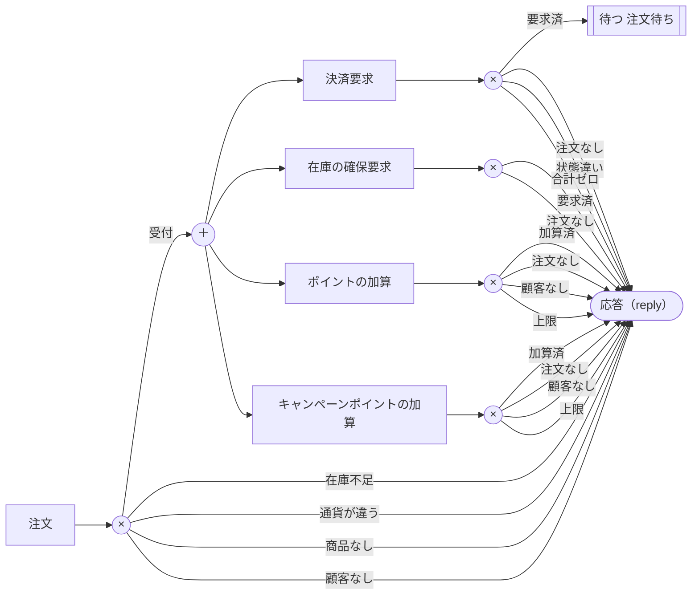
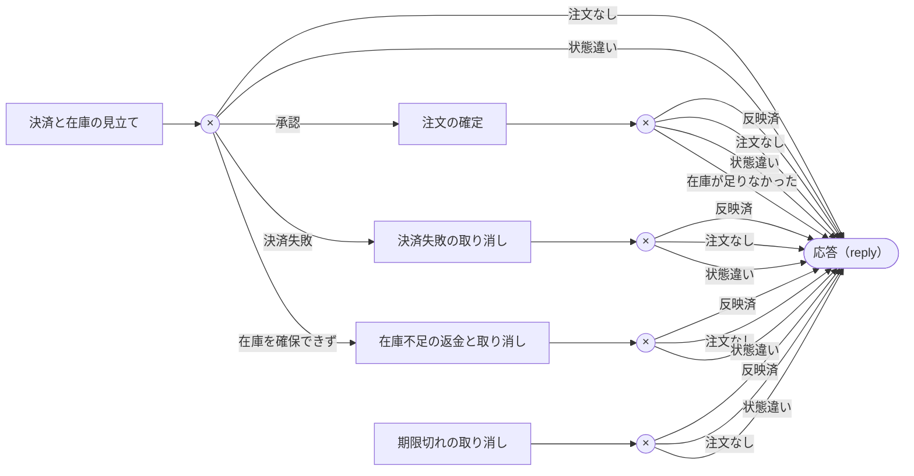
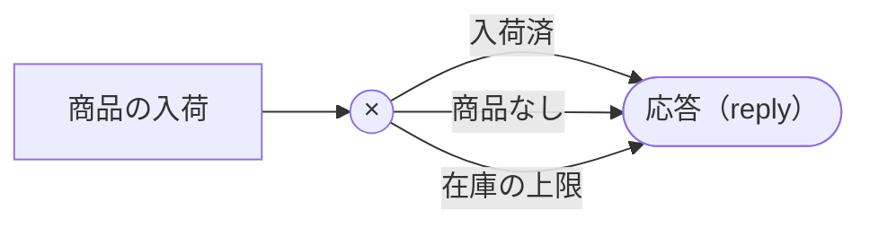
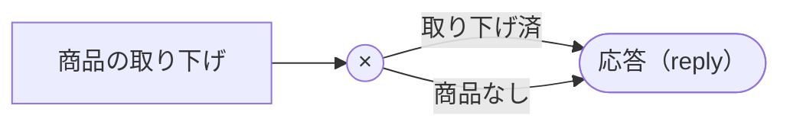
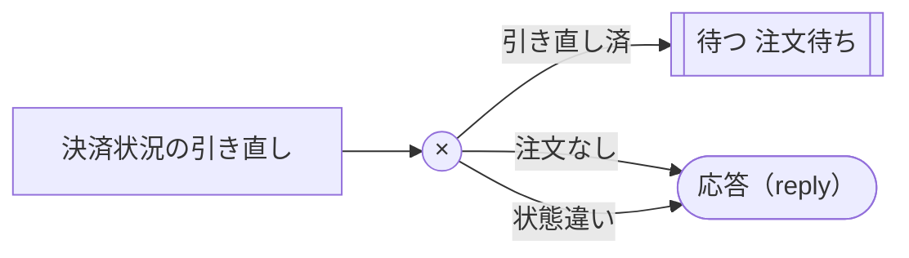

# 生成した仕様書（③）（overseas_shop.geas）

コードから生成。人が直さない。◆の欄は plan の仕様書（①）と機械で突合する。

## データ

| データ | 項目 | ◆型・範囲 | ◆必須 | ◆一意 |
|---|---|---|---|---|
| 商品 | 商品ID | ID | ○ | ○ |
| 商品 | 商品名 | 文字列 1..80 | ○ |  |
| 商品 | JANコード | 文字列 13..13 文字種 [0-9] 検査数字 gtin | ○ |  |
| 商品 | 在庫 | 整数 0..1000000 | ○ |  |
| 商品 | 通貨 | Currency | ○ |  |
| 商品 | 価格 | 金額(通貨:通貨) 0..10000000 | ○ |  |
| 顧客 | 顧客ID | ID | ○ | ○ |
| 顧客 | ポイント | 整数 0..1000000000 | ○ |  |
| 注文 | 注文ID | ID | ○ | ○ |
| 注文 | 顧客 | 顧客 を参照 | ○ |  |
| 注文 | 明細 | 商品 → 整数 1..99 | ○ |  |
| 注文 | 配送先 | 配送先（国: 文字列 2..2 文字種 [A-Z]、郵便番号: 文字列 3..10 文字種 [\-0-9A-Z]、住所: 文字列 1..80） | ○ |  |
| 注文 | 通貨 | Currency | ○ |  |
| 注文 | 合計 | 金額(通貨:通貨) 0..1000000000000 | ○ |  |
| 注文 | 状態 | 注文状態 | ○ |  |

## 状態と遷移

| データ | ◆状態 | ◆区分 |
|---|---|---|
| 注文 | 受付 | 初期 |
| 注文 | 決済要求済 | 中間 |
| 注文 | 完了 | 終了 |
| 注文 | キャンセル | 終了 |

| データ | ◆元 | ◆先 | ◆起こす処理 |
|---|---|---|---|
| 注文 | (新規) | 受付 | 注文 |
| 注文 | 受付 | 決済要求済 | 決済要求 |
| 注文 | 決済要求済 | 完了 | 注文の確定 |
| 注文 | 決済要求済 | キャンセル | 決済失敗の取り消し |
| 注文 | 決済要求済 | キャンセル | 在庫不足の返金と取り消し |
| 注文 | 決済要求済 | キャンセル | 期限切れの取り消し |

| データ | ◆元 | ◆先 | 拒否の理由 |
|---|---|---|---|
| 注文 | 完了 | キャンセル | 完了後は返品で扱う |

## 処理

| 処理 | ◆入力 | ◆読む | ◆書く | ◆結果 → 行き先 | ◆外部作用 |
|---|---|---|---|---|---|
| 注文 | 顧客ID（必須）, 明細（必須）, 配送先（必須） | 顧客, 商品.通貨, 商品.価格, 商品.在庫 | 注文 | 受付→並列［決済要求 ＋ 在庫の確保要求 ＋ ポイントの加算 ＋ キャンペーンポイントの加算］ / 在庫不足→応答 / 商品なし→応答 / 通貨が違う→応答 / 顧客なし→応答 | なし |
| 決済要求 | 注文ID（必須） | 注文.通貨, 注文.状態, 注文.合計 | 注文.状態 | 要求済→待つ 注文待ち / 注文なし→応答 / 状態違い→応答 / 合計ゼロ→応答 | 決済.請求(冪等キー=注文ID) |
| 在庫の確保要求 | 注文ID（必須） | 注文.配送先 |  | 要求済→応答 / 注文なし→応答 | 倉庫.在庫の確保(冪等キー=注文ID) |
| キャンペーンポイントの加算 | 注文ID（必須） | 顧客.ポイント, 注文.顧客 | 顧客.ポイント | 加算済→応答 / 注文なし→応答 / 顧客なし→応答 / 上限→応答 | なし |
| ポイントの加算 | 注文ID（必須） | 顧客.ポイント, 注文.顧客 | 顧客.ポイント | 加算済→応答 / 注文なし→応答 / 顧客なし→応答 / 上限→応答 | なし |
| 決済と在庫の見立て | 注文ID（必須）, 与信, 不足 | 注文.状態 |  | 承認→注文の確定 / 決済失敗→決済失敗の取り消し / 在庫を確保できず→在庫不足の返金と取り消し / 注文なし→応答 / 状態違い→応答 | なし |
| 注文の確定 | 注文ID（必須） | 注文.明細, 注文.配送先, 注文.状態, 商品.在庫 | 注文.状態, 商品.在庫 | 反映済→応答 / 注文なし→応答 / 状態違い→応答 / 在庫が足りなかった→応答 | 配送.出荷(冪等キー=注文ID) |
| 決済失敗の取り消し | 注文ID（必須） | 注文.状態 | 注文.状態 | 反映済→応答 / 注文なし→応答 / 状態違い→応答 | なし |
| 在庫不足の返金と取り消し | 注文ID（必須）, 与信（必須） | 注文.状態 | 注文.状態 | 反映済→応答 / 注文なし→応答 / 状態違い→応答 | 決済.与信の取り消し(冪等キー=注文ID) |
| 決済状況の引き直し | 注文ID（必須） | 注文.通貨, 注文.状態, 注文.合計 |  | 引き直し済→待つ 注文待ち / 注文なし→応答 / 状態違い→応答 | 決済.請求(冪等キー=注文ID) |
| 期限切れの取り消し | 注文ID（必須） | 注文.状態 | 注文.状態 | 反映済→応答 / 注文なし→応答 / 状態違い→応答 | なし |
| 商品の入荷 | 商品ID（必須）, 入荷数（必須） | 商品.在庫 | 商品.在庫 | 入荷済→応答 / 商品なし→応答 / 在庫の上限→応答 | なし |
| 商品の取り下げ | 商品ID（必須） | 商品 | 商品 | 取り下げ済→応答 / 商品なし→応答 | なし |

## フロー図 Intake（×＝結果で行き先が分かれる、＋＝並列に起こす）

## フロー図 Settlement（×＝結果で行き先が分かれる、＋＝並列に起こす）

## フロー図 Restock（×＝結果で行き先が分かれる、＋＝並列に起こす）

## フロー図 Withdrawal（×＝結果で行き先が分かれる、＋＝並列に起こす）

## フロー図 Recheck（×＝結果で行き先が分かれる、＋＝並列に起こす）

## 問い合わせ（読むだけの処理）

| 問い合わせ | ◆入力 | ◆読む | ◆条件 | ◆並び | ◆ページ |
|---|---|---|---|---|---|
| 注文一覧 |  | 顧客.顧客ID, 注文.顧客, 注文.明細, 注文.注文ID, 注文.状態 | 状態 != キャンセル |  |  |
| 商品一覧 |  | 商品.通貨, 商品.JANコード, 商品.商品名, 商品.価格, 商品.商品ID, 商品.在庫 |  |  |  |
| 顧客一覧 |  | 顧客.顧客ID, 顧客.ポイント |  |  |  |
| 顧客の注文一覧 | 顧客（必須） | 注文.通貨, 注文.顧客, 注文.明細, 注文.注文ID, 注文.状態, 注文.合計 | 顧客 一致 顧客 |  |  |
| 決済の返事待ちの注文 |  | 注文.状態 | 状態 == 決済要求済 |  |  |
| JANコードから価格を引く | JANコード（必須） | 商品.通貨, 商品.JANコード, 商品.価格, 商品.商品ID | JANコード 一致 JANコード |  |  |

## トリガ

| トリガ | ◆要因 | ◆行き先 |
|---|---|---|
| 注文待ち | 全部の応答 決済が済んだ（与信が取れたか、拒否か） ＋ 倉庫の返事（足りない商品があれば入る） | 決済と在庫の見立て |
| 注文待ち | 期限 現在+30分 | 期限切れの取り消し |

## 応答の中身（外から返ってくる内容。入出力型）

| 応答 | ◆中身 |
|---|---|
| 決済が済んだ（与信が取れたか、拒否か） | 与信 |
| 倉庫の返事（足りない商品があれば入る） | 不足 |

## slot の決め方（サーバーが決める値。上の行から順に、最初に当てはまった値になる）

| slot | 条件 | 値 |
|---|---|---|
| 税率 | 通貨 = JPY | 10/100 |
| 税率 | 上のどれでもない | 0/1 |
| 送料 | 通貨 = JPY かつ 配送先.国 = JP | 500 |
| 送料 | 通貨 = JPY | 2500 |
| 送料 | 配送先.国 = JP | 1500 |
| 送料 | 上のどれでもない | 3000 |

## 開発用の模擬（外部作用の返事。先頭が平常。開発用の操作パネルで切り替える）

| 外部作用 | 返ってくる応答 | 結果の種類（返事に入る中身） |
|---|---|---|
| 決済.請求 | 決済が済んだ（与信が取れたか、拒否か） | 承認（与信） ／ 拒否 |
| 倉庫.在庫の確保 | 倉庫の返事（足りない商品があれば入る） | 確保できた ／ 在庫不足（不足） |

## 返事の合流先（外部作用の返事が入るトリガ）

| 外部作用 | ◆合流先のトリガ |
|---|---|
| 倉庫.在庫の確保 | 注文待ち |

## 外部作用（外へ出す内容。入出力型）

| 外部作用 | ◆出す内容 |
|---|---|
| 決済.請求 | 注文ID: ID, 通貨: Currency, 金額: 金額(通貨:通貨) |
| 決済.与信の取り消し | 注文ID: ID, 与信: ID |
| 倉庫.在庫の確保 | 注文ID: ID, 届け先: 配送先（国: 文字列 2..2 文字種 [A-Z]、郵便番号: 文字列 3..10 文字種 [\-0-9A-Z]、住所: 文字列 1..80） |
| 配送.出荷 | 注文ID: ID, 届け先: 配送先（国: 文字列 2..2 文字種 [A-Z]、郵便番号: 文字列 3..10 文字種 [\-0-9A-Z]、住所: 文字列 1..80） |

## 出来事（外の出来事をきっかけに起こす処理）

| 出来事 | ◆起こし方 | ◆処理 |
|---|---|---|
| つながりが戻った | つながりが戻ったとき: 各 決済の返事待ちの注文 | 決済状況の引き直し |

## 画面（入口は最初の画面と entry の画面。入力欄の「←」は選ぶ元の問い合わせ）

| 画面 | ◆見せる | ◆入力欄 | ◆受け取る値 | ◆入口 | ◆選ばせる slot | ◆URL |
|---|---|---|---|---|---|---|
| 商品一覧の画面 | 商品一覧 |  |  | ○ |  | /products |
| 注文の画面 |  | 顧客ID←顧客一覧, 明細←商品一覧, 配送先 | 商品ID |  | 通貨 | /orders/new |
| 注文の履歴の画面 | 顧客の注文一覧 | 顧客←顧客一覧 |  |  |  | /customers/:customer_id/orders |
| 価格の確認の画面（Chrome 拡張） | JANコードから価格を引く | JANコード |  | ○ |  | /product_prices/:jan |
| 商品の管理の画面 | 商品一覧 | 商品ID←商品一覧, 入荷数 |  | ○ |  | /products/:id/edit |

## 画面遷移

| 画面 | ◆操作 | ◆結果 | ◆行き先 |
|---|---|---|---|
| 商品一覧の画面 | 行を選ぶ |  | 注文の画面 |
| 注文の画面 | 注文 | 受付 | 注文の履歴の画面 |
| 注文の画面 | 注文 | 在庫不足 | そのまま |
| 注文の画面 | 注文 | 商品なし | そのまま |
| 注文の画面 | 注文 | 通貨が違う | そのまま |
| 注文の画面 | 注文 | 顧客なし | そのまま |
| 商品の管理の画面 | 商品の入荷 | 入荷済 | そのまま |
| 商品の管理の画面 | 商品の入荷 | 商品なし | そのまま |
| 商品の管理の画面 | 商品の入荷 | 在庫の上限 | そのまま |
| 商品の管理の画面 | 商品の取り下げ | 取り下げ済 | そのまま |
| 商品の管理の画面 | 商品の取り下げ | 商品なし | そのまま |

## ブラウザ拡張（ページに出す画面。ページからの読み方も宣言から生成）

| 画面 | ページ | 見せる問い合わせ | ページから読む値 | 読み方 |
|---|---|---|---|---|
| 価格の確認の画面（Chrome 拡張） | *://www.amazon.co.jp/*, *://www.amazon.com/* | JANコードから価格を引く | JANコード | ASINを、URL（/(?:dp|gp/product|gp/aw/d)/([A-Z0-9]{10})(?:[/?]|$)）・要素 input#ASINから読む。値は、JAN・EAN・GTIN の行から読む。読めなければ対応表（4件）から引く |

## 画面デザイン（突合しない。配置と色）

| 画面 | 指定 | 値 |
|---|---|---|
| 商品一覧の画面 | layout | grid |
| 商品一覧の画面 | accent | #0b5cad |
| 商品一覧の画面 | mode | light |
| 注文の画面 | layout | form |
| 注文の画面 | accent | #0b5cad |
| 注文の画面 | mode | light |
| 注文の履歴の画面 | layout | list |
| 注文の履歴の画面 | accent | #0b5cad |
| 注文の履歴の画面 | mode | light |
| 価格の確認の画面（Chrome 拡張） | layout | stack |
| 価格の確認の画面（Chrome 拡張） | accent | #e47911 |
| 価格の確認の画面（Chrome 拡張） | mode | dark |
| 商品の管理の画面 | layout | form |
| 商品の管理の画面 | accent | #8a5a00 |

## 削除（消してよい状態と、消したときの参照元の扱い）

| データ | 消してよい状態 | 参照元の扱い |
|---|---|---|
| 商品 | 消せる | 注文.明細→そのまま残す |

## ルート（URL。結果の種類ごとの HTTP の状態つき）

| メソッド | 経路 | 動作 | 呼ぶもの | 結果→状態 |
|---|---|---|---|---|
| POST | /orders | create | 注文 | 受付→201, 在庫不足→422, 商品なし→404, 通貨が違う→422, 顧客なし→404 |
| GET | /orders | index | 注文一覧 |  |
| POST | /payment_requests | create | 決済要求 | 要求済→201, 注文なし→404, 状態違い→409, 合計ゼロ→422 |
| POST | /stock_holds | create | 在庫の確保要求 | 要求済→201, 注文なし→404 |
| POST | /point_grants | create | ポイントの加算 | 加算済→201, 注文なし→404, 顧客なし→404, 上限→409 |
| POST | /campaign_point_grants | create | キャンペーンポイントの加算 | 加算済→201, 注文なし→404, 顧客なし→404, 上限→409 |
| POST | /order_settlements | create | 決済と在庫の見立て | 承認→201, 決済失敗→201, 在庫を確保できず→201, 注文なし→404, 状態違い→409 |
| POST | /order_completions | create | 注文の確定 | 反映済→201, 注文なし→404, 状態違い→409, 在庫が足りなかった→422 |
| POST | /unpaid_cancellations | create | 決済失敗の取り消し | 反映済→201, 注文なし→404, 状態違い→409 |
| POST | /refund_cancellations | create | 在庫不足の返金と取り消し | 反映済→201, 注文なし→404, 状態違い→409 |
| POST | /expiry_cancellations | create | 期限切れの取り消し | 反映済→201, 注文なし→404, 状態違い→409 |
| POST | /order_recheck_requests | create | 決済状況の引き直し | 引き直し済→201, 注文なし→404, 状態違い→409 |
| GET | /products | index | 商品一覧 |  |
| PUT | /products/:id | update | 商品の入荷 | 入荷済→200, 商品なし→404, 在庫の上限→409 |
| DELETE | /products/:id | destroy | 商品の取り下げ | 取り下げ済→200, 商品なし→404 |
| GET | /customers | index | 顧客一覧 |  |
| GET | /customers/:customer_id/orders | index | 顧客の注文一覧 |  |
| GET | /awaiting_payment_orders | index | 決済の返事待ちの注文 |  |
| GET | /product_prices/:jan | show | JANコードから価格を引く |  |
| POST | /reconnections | create | つながりが戻った |  |

## 不変条件

| ◆内容 | 検査の結果 |
|---|---|
| Product: stock >= 0 | place_order: 対象外／request_payment: 対象外／request_stock_hold: 対象外／grant_campaign_points: 対象外／grant_points: 対象外／settle_order: 対象外／complete_order: 証明済み（減算の前に不足を確認している）／cancel_unpaid: 対象外／refund_and_cancel: 対象外／recheck_payment: 対象外／expire_order: 対象外／restock_product: 証明済み（書く値は 0 以上）／withdraw_product: 対象外 |
| Order: status == PaymentRequested なら total > 0 | place_order: 証明済み（新規作成はPaymentRequested以外）／request_payment: 証明済み（PaymentRequestedにする前に total > 0 を確認している）／request_stock_hold: 対象外／grant_campaign_points: 対象外／grant_points: 対象外／settle_order: 対象外／complete_order: 証明済み（PaymentRequested以外にする）／cancel_unpaid: 証明済み（PaymentRequested以外にする）／refund_and_cancel: 証明済み（PaymentRequested以外にする）／recheck_payment: 対象外／expire_order: 証明済み（PaymentRequested以外にする）／restock_product: 対象外／withdraw_product: 対象外 |

## 指定事項（コードに書かれた、既定でない指定）

| 項目 | ◆指定 |
|---|---|
| 注文.丸め | 切り捨て(通貨) |

## 名前と表示名（説明コメント /// から）

| 名前 | 表示名 |
|---|---|
| StockCount | 既定: 在庫数 |
| Quantity | 既定: 数量 |
| ProductQuantity | 既定: 商品数量 |
| UnitPrice | 既定: 単価 |
| ShippingFee | 既定: 送料 |
| OrderTotal | 既定: 合計金額 |
| TaxRateValue | 既定: 税率値 |
| IdSet | 既定: ID集合 |
| PointCount | 既定: ポイント |
| CountryCode | 既定: 国コード |
| PostalCode | 既定: 郵便番号 |
| AddressLine | 既定: 住所の行 |
| ProductName | 既定: 商品名 |
| JanCode | 既定: JANコード |
| Address | 既定: 配送先 |
| country | 既定: 国 |
| postal_code | 既定: 郵便番号 |
| line | 既定: 住所 |
| Product | 既定: 商品 |
| product_id | 既定: 商品ID |
| name | 既定: 商品名 |
| jan | 既定: JANコード |
| stock | 既定: 在庫 |
| currency | 既定: 通貨 |
| price | 既定: 価格 |
| Customer | 既定: 顧客 |
| customer_id | 既定: 顧客ID |
| points | 既定: ポイント |
| Order | 既定: 注文 |
| order_id | 既定: 注文ID |
| customer | 既定: 顧客 |
| items | 既定: 明細 |
| ship_to | 既定: 配送先 |
| total | 既定: 合計 |
| status | 既定: 状態 |
| OrderStatus | 既定: 注文状態 |
| Received | 既定: 受付 |
| PaymentRequested | 既定: 決済要求済 |
| Completed | 既定: 完了 |
| Canceled | 既定: キャンセル |
| PlaceOrderResult | 既定: 受注結果 |
| OutOfStock | 既定: 在庫不足 |
| short | 既定: 不足 |
| NoSuchProduct | 既定: 商品なし |
| unregistered | 既定: 未登録 |
| OtherCurrency | 既定: 通貨が違う |
| mismatched | 既定: 違う商品 |
| NoSuchCustomer | 既定: 顧客なし |
| RequestPaymentResult | 既定: 決済要求結果 |
| Requested | 既定: 要求済 |
| NoSuchOrder | 既定: 注文なし |
| WrongStatus | 既定: 状態違い |
| ZeroTotal | 既定: 合計ゼロ |
| HoldResult | 既定: 在庫確保の要求結果 |
| HoldRequested | 既定: 要求済 |
| PointsResult | 既定: ポイント結果 |
| Granted | 既定: 加算済 |
| PointsFull | 既定: 上限 |
| SettleResult | 既定: 決済と在庫の結果の見立て |
| Approved | 既定: 承認 |
| PaymentFailed | 既定: 決済失敗 |
| StockShort | 既定: 在庫を確保できず |
| auth_id | 既定: 与信 |
| CancelResult | 既定: 取り消し結果 |
| Applied | 既定: 反映済 |
| FinishResult | 既定: 確定結果 |
| StockLacking | 既定: 在庫が足りなかった |
| Payment | 既定: 決済 |
| charge | 既定: 請求 |
| amount | 既定: 金額 |
| refund | 既定: 与信の取り消し |
| Warehouse | 既定: 倉庫 |
| hold | 既定: 在庫の確保 |
| to | 既定: 届け先 |
| Shipping | 既定: 配送 |
| ship | 既定: 出荷 |
| PaymentSettled | 既定: 決済が済んだ（与信が取れたか、拒否か） |
| Declined | 既定: 拒否 |
| StockSettled | 既定: 倉庫の返事（足りない商品があれば入る） |
| Held | 既定: 確保できた |
| Short | 既定: 在庫不足 |
| place_order | 既定: 注文 |
| tax_rate | 既定: 税率 |
| shipping | 既定: 送料 |
| request_payment | 既定: 決済要求 |
| request_stock_hold | 既定: 在庫の確保要求 |
| grant_campaign_points | 既定: キャンペーンポイントの加算 |
| grant_points | 既定: ポイントの加算 |
| settle_order | 既定: 決済と在庫の見立て |
| complete_order | 既定: 注文の確定 |
| cancel_unpaid | 既定: 決済失敗の取り消し |
| refund_and_cancel | 既定: 在庫不足の返金と取り消し |
| RecheckResult | 既定: 決済状況の引き直し結果 |
| Rechecked | 既定: 引き直し済 |
| recheck_payment | 既定: 決済状況の引き直し |
| expire_order | 既定: 期限切れの取り消し |
| RestockResult | 既定: 入荷の結果 |
| Restocked | 既定: 入荷済 |
| StockFull | 既定: 在庫の上限 |
| WithdrawResult | 既定: 取り下げの結果 |
| Withdrawn | 既定: 取り下げ済 |
| restock_product | 既定: 商品の入荷 |
| quantity | 既定: 入荷数 |
| withdraw_product | 既定: 商品の取り下げ |
| order_list | 既定: 注文一覧 |
| item_count | 既定: 点数 |
| product_list | 既定: 商品一覧 |
| customer_list | 既定: 顧客一覧 |
| orders_of | 既定: 顧客の注文一覧 |
| awaiting_payment | 既定: 決済の返事待ちの注文 |
| price_by_jan | 既定: JANコードから価格を引く |
| Intake | 既定: 注文受付 |
| OrderPending | 既定: 注文待ち |
| Settlement | 既定: 確定の流れ |
| Restock | 既定: 商品の入荷の流れ |
| Withdrawal | 既定: 商品の取り下げの流れ |
| Recheck | 既定: 決済状況の引き直しの流れ |
| Reconnected | 既定: つながりが戻った |
| ProductList | 既定: 商品一覧の画面 |
| OrderForm | 既定: 注文の画面 |
| MyOrders | 既定: 注文の履歴の画面 |
| PriceCheck | 既定: 価格の確認の画面（Chrome 拡張） |
| ProductAdmin | 既定: 商品の管理の画面 |
| Orders | 既定: 注文 |
| PaymentRequests | 既定: 決済要求 |
| StockHolds | 既定: 在庫確保 |
| PointGrants | 既定: ポイント付与 |
| CampaignPointGrants | 既定: キャンペーンポイント付与 |
| OrderSettlements | 既定: 決済と在庫の見立て |
| OrderCompletions | 既定: 注文の確定 |
| UnpaidCancellations | 既定: 決済失敗の取り消し |
| RefundCancellations | 既定: 返金つきの取り消し |
| ExpiryCancellations | 既定: 期限切れの取り消し |
| OrderRecheckRequests | 既定: 決済状況の引き直し依頼 |
| Products | 既定: 商品 |
| Customers | 既定: 顧客 |
| CustomerOrders | 既定: 顧客の注文 |
| AwaitingPaymentOrders | 既定: 決済待ちの注文 |
| ProductPrices | 既定: 商品の価格 |
| Reconnections | 既定: つながりが戻った |

## 実現の報告（振る舞いの仕様には含めない）

- 物理数 商品.在庫: u32
- 物理数 商品.価格: i64
- 物理数 顧客.ポイント: u32
- 物理数 注文.合計: i64
- 処理 注文 の文脈: 参照 通貨: Currency（配備時に埋まる）、参照 税率: 割合 0..1（配備時に埋まる）、参照 送料: 金額(通貨:通貨) 0..100000（配備時に埋まる）、採番 注文（実行のたびに基盤が代入）

## 検査の結果

- 指摘なし

## 内部 URL ごとの確認の網羅（確認できた 16 / 52、30%。具体例とユースケースが当たっているか）

| メソッド | 経路 | 結果 | 状態 | 具体例 | ユースケース | 確認 |
|---|---|---|---|---|---|---|
| POST | /orders | 受付 | 201 | UX6 | 商品を見つけて注文する、在庫が足りなかった注文をやり直す、返事が来ない注文は、30分で取り消される | ○ |
| POST | /orders | 在庫不足 | 422 |  | 在庫が足りなかった注文をやり直す | ○ |
| POST | /orders | 商品なし | 404 |  | 注文が受け付けられない理由を知る | ○ |
| POST | /orders | 通貨が違う | 422 | UX4 | 注文が受け付けられない理由を知る | ○ |
| POST | /orders | 顧客なし | 404 | UX5 | 注文が受け付けられない理由を知る | ○ |
| GET | /orders |  | 200 |  |  | 未 |
| POST | /payment_requests | 要求済 | 201 |  |  | 未 |
| POST | /payment_requests | 注文なし | 404 |  |  | 未 |
| POST | /payment_requests | 状態違い | 409 |  |  | 未 |
| POST | /payment_requests | 合計ゼロ | 422 |  |  | 未 |
| POST | /stock_holds | 要求済 | 201 |  |  | 未 |
| POST | /stock_holds | 注文なし | 404 |  |  | 未 |
| POST | /point_grants | 加算済 | 201 |  |  | 未 |
| POST | /point_grants | 注文なし | 404 |  |  | 未 |
| POST | /point_grants | 顧客なし | 404 |  |  | 未 |
| POST | /point_grants | 上限 | 409 |  |  | 未 |
| POST | /campaign_point_grants | 加算済 | 201 |  |  | 未 |
| POST | /campaign_point_grants | 注文なし | 404 |  |  | 未 |
| POST | /campaign_point_grants | 顧客なし | 404 |  |  | 未 |
| POST | /campaign_point_grants | 上限 | 409 |  |  | 未 |
| POST | /order_settlements | 承認 | 201 |  |  | 未 |
| POST | /order_settlements | 決済失敗 | 201 |  |  | 未 |
| POST | /order_settlements | 在庫を確保できず | 201 |  |  | 未 |
| POST | /order_settlements | 注文なし | 404 | UX8 |  | ○ |
| POST | /order_settlements | 状態違い | 409 |  |  | 未 |
| POST | /order_completions | 反映済 | 201 |  |  | 未 |
| POST | /order_completions | 注文なし | 404 |  |  | 未 |
| POST | /order_completions | 状態違い | 409 |  |  | 未 |
| POST | /order_completions | 在庫が足りなかった | 422 | UX16 |  | ○ |
| POST | /unpaid_cancellations | 反映済 | 201 |  |  | 未 |
| POST | /unpaid_cancellations | 注文なし | 404 |  |  | 未 |
| POST | /unpaid_cancellations | 状態違い | 409 |  |  | 未 |
| POST | /refund_cancellations | 反映済 | 201 |  |  | 未 |
| POST | /refund_cancellations | 注文なし | 404 |  |  | 未 |
| POST | /refund_cancellations | 状態違い | 409 |  |  | 未 |
| POST | /expiry_cancellations | 反映済 | 201 |  |  | 未 |
| POST | /expiry_cancellations | 注文なし | 404 |  |  | 未 |
| POST | /expiry_cancellations | 状態違い | 409 |  |  | 未 |
| POST | /order_recheck_requests | 引き直し済 | 201 |  |  | 未 |
| POST | /order_recheck_requests | 注文なし | 404 |  |  | 未 |
| POST | /order_recheck_requests | 状態違い | 409 |  |  | 未 |
| GET | /products |  | 200 |  | 取り下げた商品を扱おうとして失敗する、商品を入荷する、商品を取り下げる、商品を見つけて注文する、在庫が足りなかった注文をやり直す、注文が受け付けられない理由を知る、返事が来ない注文は、30分で取り消される | ○ |
| PUT | /products/:id | 入荷済 | 200 | UX10 | 商品を入荷する | ○ |
| PUT | /products/:id | 商品なし | 404 | UX11, UX15 | 取り下げた商品を扱おうとして失敗する | ○ |
| PUT | /products/:id | 在庫の上限 | 409 |  | 商品を入荷する | ○ |
| DELETE | /products/:id | 取り下げ済 | 200 | UX13 | 商品を取り下げる | ○ |
| DELETE | /products/:id | 商品なし | 404 | UX14 | 取り下げた商品を扱おうとして失敗する | ○ |
| GET | /customers |  | 200 |  | 商品を見つけて注文する、在庫が足りなかった注文をやり直す、注文が受け付けられない理由を知る、返事が来ない注文は、30分で取り消される | ○ |
| GET | /customers/:customer_id/orders |  | 200 |  | 商品を見つけて注文する、返事が来ない注文は、30分で取り消される | ○ |
| GET | /awaiting_payment_orders |  | 200 |  |  | 未 |
| GET | /product_prices/:jan |  | 200 |  | Amazon の商品ページで、お店の価格を見る、JAN が分からない商品では、分からないと知る、お店で扱っていない商品では、扱っていないと知る、商品ページでなければ、何も出さない、商品ページに JAN があれば、それで価格を見る | ○ |
| POST | /reconnections |  | － |  |  | 未 |

